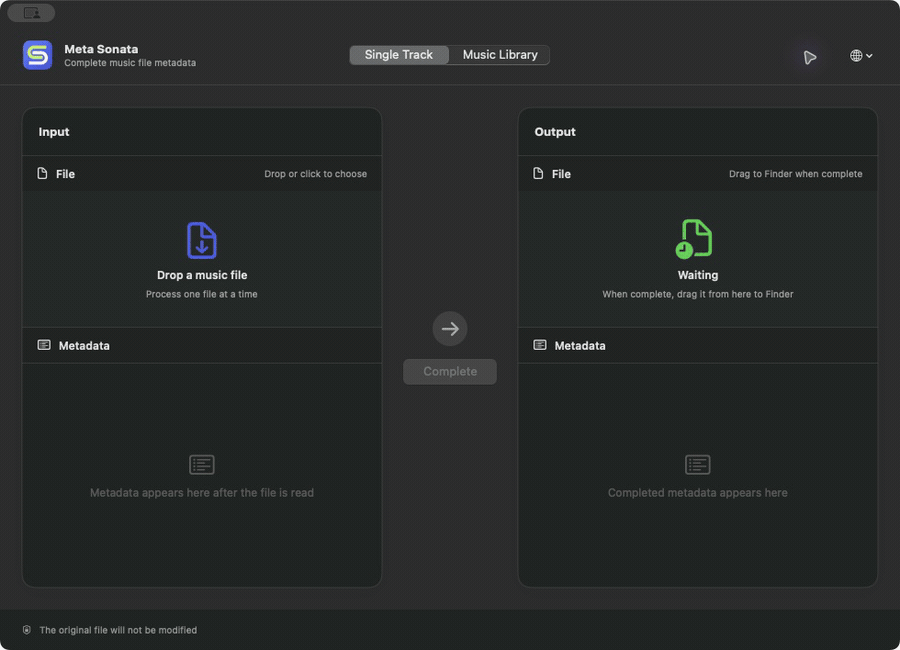
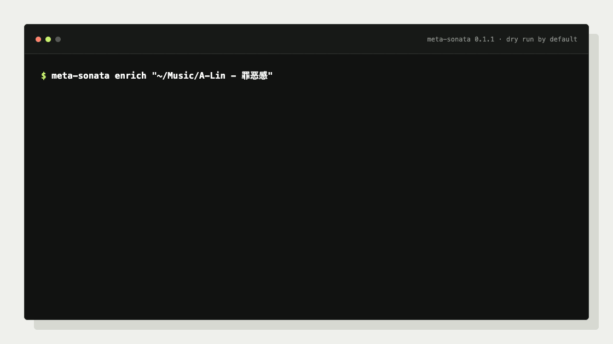

# meta-sonata

[](https://github.com/sendingE/meta-sonata/actions/workflows/tests.yml)
[](https://github.com/sendingE/meta-sonata/releases/latest)
[](https://pypi.org/project/meta-sonata/)
[](https://www.python.org/)
[](https://github.com/sendingE/meta-sonata/blob/main/LICENSE)

**English** | [简体中文](https://github.com/sendingE/meta-sonata/blob/main/README.zh-CN.md)

Meta Sonata turns incomplete music files into a clean, consistent library. Use
the standalone macOS app for everyday organizing, or the CLI for batch work and
automation.

## macOS App

Drop in a track, review what Meta Sonata found, then drag the completed copy
back to Finder. No Python, terminal, or separate service is required.

[Download the latest Apple-silicon DMG](https://github.com/sendingE/meta-sonata/releases/latest).



_[Demo media attribution](https://github.com/sendingE/meta-sonata/blob/main/docs/assets/ATTRIBUTION.md)_

### What You Get

- **Complete music files:** fill missing album details, dates, artwork, and synced lyrics in one pass.
- **A consistent library:** Meta Sonata recognizes the same song across singles, albums, and compilations while preserving each release's own details.
- **A safe original:** the app creates a new completed copy and never changes the source file.
- **One place to browse:** open a music folder to view its tags, artwork, audio details, and lyrics.
- **Work that keeps moving:** if one online source is unavailable, Meta Sonata continues with the information and sources it can use.

The app supports English, Simplified Chinese, Traditional Chinese, Japanese,
Korean, French, German, Spanish, and Brazilian Portuguese.

The current DMG is ad-hoc signed and not Apple-notarized, so macOS may require
Control-click → **Open** on first launch.

## CLI Quick Start

```bash
pipx install meta-sonata
```

Or install it with `uv`:

```bash
uv tool install meta-sonata
```

Preview the metadata Meta Sonata finds. Nothing is written:

```bash
meta-sonata enrich "/music/album"
```

Fetch and write metadata, cover art, and lyrics in one step:

```bash
meta-sonata enrich "/music/album" --write
```

Both commands accept an album folder or a larger music directory. Existing tags,
filenames, and folder structure are trusted first; online sources fill the gaps.



Preview before writing:

```text
scan: root=/music/album files=12 album_groups=1 loose_tracks=0 max_depth=3
resolve: 1/1 /music/album
lyrics: 1/1 /music/album
dry run: 1 plan(s)
- album: Artist / Album: artist=Artist  album=Album  year=2006  tracks=12  confidence=0.96  lyrics=11/12
nothing written; pass --write to apply
```

`enrich` enables metadata lookup, cover lookup, and lyrics by default. It scans
up to three directory levels; use `--max-depth N` or `--recursive` when needed.

## What It Can Fill

| Area | Fields |
| --- | --- |
| Identity | title, artist, album artist, album, track/disc number |
| Release | date, label, catalog number, barcode, release type |
| Media | embedded cover art, synced LRC, plain lyrics |

Album metadata sources: **MusicBrainz**, **iTunes**, and **NetEase**.

Lyric sources: **QQ Music**, **NetEase**, **KuGou**, **KuWo**, and **Migu**.

```bash
meta-sonata sources
```

## Put It in a Pipeline

Run it after download/extraction/CUE splitting and before the final library sync:

```bash
meta-sonata enrich "/staging/new-music" \
  --changed-only \
  --state-dir "/var/lib/meta-sonata" \
  --write
```

Incremental state stays outside music folders. No marker files are added to albums.

## Optional Metadata Browser

```bash
meta-sonata web "/music" --host 127.0.0.1 --port 8765
```

Open `http://127.0.0.1:8765/` to browse audio files, core tags, source IDs,
technical details, covers, and embedded lyrics. The web UI has no write endpoints.


_Shown with CC-licensed audio and artwork from Nine Inch Nails' The Slip. See the [asset attribution](https://github.com/sendingE/meta-sonata/blob/main/docs/assets/ATTRIBUTION.md)._

## Safety

- Every write command is a dry run unless `--write` is present.
- Low-confidence lyrics and ambiguous release identities are skipped.
- Mixed loose tracks are not forced into a fake album.
- Real libraries can be protected with `META_SONATA_PROTECTED_PATHS`.
- Tests generate silent FLAC files; no copyrighted media is committed.

## More

- [Detailed guide](https://github.com/sendingE/meta-sonata/blob/main/docs/guide.md)
- [Changelog](https://github.com/sendingE/meta-sonata/blob/main/CHANGELOG.md)
- [Public test-fixture policy](https://github.com/sendingE/meta-sonata/blob/main/tests/README.md)
- [MIT License](https://github.com/sendingE/meta-sonata/blob/main/LICENSE)

Python 3.9+ is supported. The project is currently an early `0.2.x` release;
unofficial provider endpoints may change or be rate-limited.
