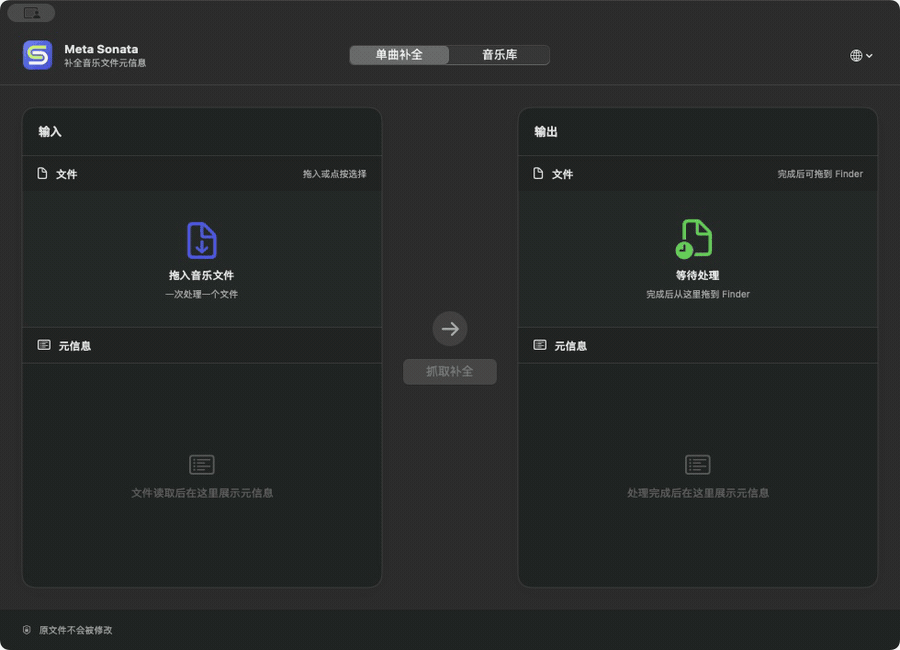
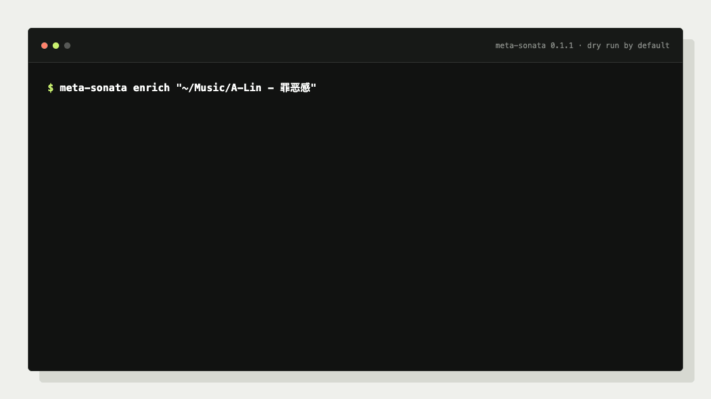
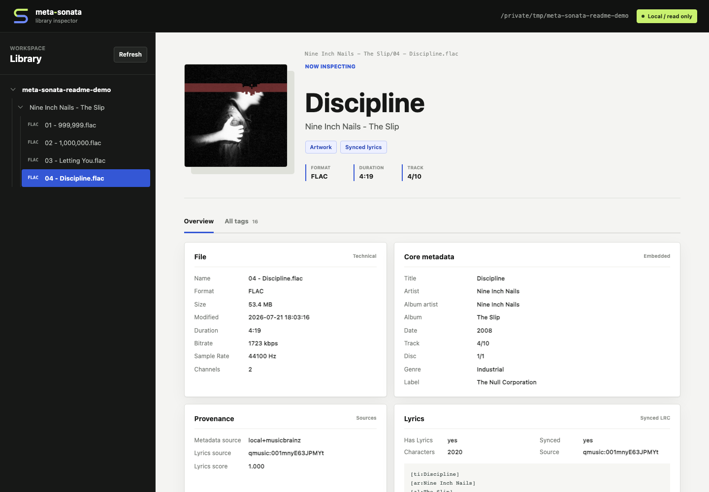

# meta-sonata

[](https://github.com/sendingE/meta-sonata/actions/workflows/tests.yml)
[](https://github.com/sendingE/meta-sonata/releases/latest)
[](https://pypi.org/project/meta-sonata/)
[](https://www.python.org/)
[](https://github.com/sendingE/meta-sonata/blob/main/LICENSE)

[English](https://github.com/sendingE/meta-sonata) | **简体中文**

Meta Sonata 帮你把信息残缺的音乐文件整理成完整、统一的音乐库。日常整理直接使用
独立 macOS App；批量处理和自动化则使用 CLI。

## macOS App

拖入一首歌，确认 Meta Sonata 找到的内容，再把补全后的副本拖回 Finder。无需安装
Python，不用打开终端，也不用另外启动服务。

[下载最新版 Apple 芯片 DMG](https://github.com/sendingE/meta-sonata/releases/latest)。



_[演示素材署名](https://github.com/sendingE/meta-sonata/blob/main/docs/assets/ATTRIBUTION.md)_

### 你能得到什么

- **一次补齐信息：** 自动补上专辑、日期、封面和同步歌词。
- **更统一的音乐库：** 同一首歌出现在单曲、专辑或精选集时，会被关联在一起，同时保留各自的发行信息。
- **原文件始终安全：** App 只生成补全后的新副本，不会修改原文件。
- **集中浏览音乐：** 打开本地文件夹即可查看标签、封面、音频参数和歌词。
- **不中断整理流程：** 某个在线来源暂时不可用时，仍会使用已有信息和其他可用来源继续处理。

当前支持英语、简体中文、繁体中文、日语、韩语、法语、德语、西班牙语和巴西
葡萄牙语。

macOS 安装包已使用 Developer ID 签名，并通过 Apple 公证。

## CLI 快速开始

```bash
pipx install meta-sonata
```

也可以使用 `uv` 安装：

```bash
uv tool install meta-sonata
```

查询并预览 Meta Sonata 找到的元数据，不会写入文件：

```bash
meta-sonata enrich "/音乐/待处理专辑"
```

一键抓取并写入元数据、封面和歌词：

```bash
meta-sonata enrich "/音乐/待处理专辑" --write
```

两个命令都可以处理单张专辑或更大的音乐目录。Meta Sonata 优先相信已有标签、
文件名和目录结构，再使用在线数据源补全缺失信息。



写入前可以先预览：

```text
scan: root=/音乐/待处理专辑 files=12 album_groups=1 loose_tracks=0 max_depth=3
resolve: 1/1 /音乐/待处理专辑
lyrics: 1/1 /音乐/待处理专辑
dry run: 1 plan(s)
- album: 歌手 / 专辑: artist=歌手  album=专辑  year=2006  tracks=12  confidence=0.96  lyrics=11/12
nothing written; pass --write to apply
```

`enrich` 默认启用元数据、封面和歌词抓取，并向下发现三层目录。可以使用
`--max-depth N` 指定深度，或使用 `--recursive` 无限递归。

## 能补全什么？

| 类别 | 字段 |
| --- | --- |
| 歌曲身份 | 标题、歌手、专辑歌手、专辑、曲目号、碟号 |
| 发行信息 | 日期、厂牌、目录编号、条码、发行类型 |
| 媒体内容 | 内嵌封面、同步 LRC、普通歌词 |

专辑元数据来源：**MusicBrainz**、**iTunes**、**网易云音乐**。

歌词来源：**QQ 音乐**、**网易云音乐**、**酷狗**、**酷我**、**咪咕**。

```bash
meta-sonata sources
```

## 接入自动化流程

建议放在下载、解压、CUE 分轨之后，最终同步到音乐库之前：

```bash
meta-sonata enrich "/staging/new-music" \
  --changed-only \
  --state-dir "/var/lib/meta-sonata" \
  --write
```

增量状态保存在音乐目录之外，不会在专辑中留下标记文件。

## 可选的 metadata 浏览器

```bash
meta-sonata web "/音乐" --host 127.0.0.1 --port 8765
```

打开 `http://127.0.0.1:8765/`，可以浏览音频文件、核心标签、来源 ID、
音频参数、封面和内嵌歌词。Web 界面只读，没有写入接口。



_截图使用 Nine Inch Nails《The Slip》的 CC 授权音频与封面，详见[素材署名](https://github.com/sendingE/meta-sonata/blob/main/docs/assets/ATTRIBUTION.md)。_

## 安全设计

- 没有 `--write` 时，所有写入命令都只做预演。
- 低可信歌词和存在歧义的发行版身份会被跳过。
- 混杂散歌不会被强行归入一个虚假专辑。
- 可通过 `META_SONATA_PROTECTED_PATHS` 保护真实音乐库。
- 测试只生成静音 FLAC，仓库不包含受版权保护的媒体文件。

## 更多文档

- [完整使用手册（英文）](https://github.com/sendingE/meta-sonata/blob/main/docs/guide.md)
- [版本记录](https://github.com/sendingE/meta-sonata/blob/main/CHANGELOG.md)
- [公开测试素材规范](https://github.com/sendingE/meta-sonata/blob/main/tests/README.md)
- [MIT License](https://github.com/sendingE/meta-sonata/blob/main/LICENSE)

支持 Python 3.9+。当前属于早期 `0.2.x` 版本，非官方数据接口可能发生变化
或受到限流。
